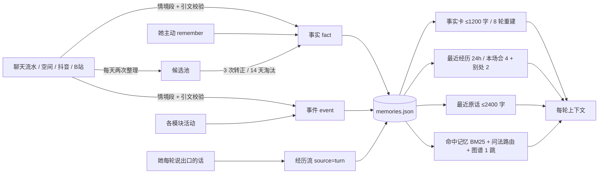
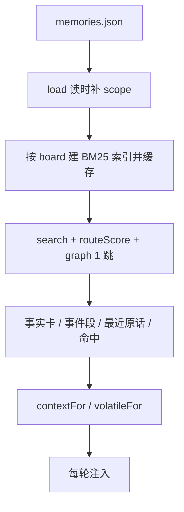

# 架构

> 这是 `docs/design.md` 的图解版，适合第一次读仓库的人先看这张图。

## 1. 写入侧 → 存储 → 注入侧



**关键取舍**：卡是“事实的投影”，不是另一个库；事件单独一段、带日期；候选池只收低置信内容；注入前按板块过滤。

## 2. 五板块 + 三个特殊桶

| scope | 负责什么 | 可见范围 |
|---|---|---|
| `owner` | 主人私聊里的偏好、约定、私事 | 主人私聊 + 她自己的经历 |
| `group:<群号>`（另有 `group` 跨群公共） | 某个群的人、梗、群内事件 | 只在该群 |
| `douyin` | 抖音公开活动：评论、作品、刷到的内容 | 抖音 system 会话轻量版 |
| `friend:<QQ或名字>` | 她自己的朋友 | 对应私聊 |
| `self` | 她自己的经历、空间日记 | 她自己的视角 |
| `quarantine` | 导入旧档案先隔离 | 不注入 |
| `public:bili` | B 站公开活动单独一桶 | 不和抖音/群混 |
| `global` | 人工审核过的公共知识 | 单独 |

**fail-closed**：缺 scope、板块算不出来、空 board → 一律不可见。宁可少给，也不串味。

## 3. 四层注入

| 层 | 内容 | 约束 |
|---|---|---|
| 事实卡 | 长期事实按人/槽位压缩 | ≤1200 字，每 8 轮重建，中间复用缓存 |
| 最近经历 | 24h 内事件 + 她的经历 | 本场合 4 条 + 别处 2 条，带日期 |
| 最近原话 | 最近若干轮净对话 | ≤2400 字，防 DSH 压缩失忆 |
| 命中记忆 | 按这一轮的话 BM25 检索 | 最多 3 条，先按板块过滤再打分 |

## 4. 事实 vs 经历

- **事实 fact**：把日期拿掉还成立（称呼、喜好、身份、约定、规矩、关系定位）；不衰减、不带日期、进事实卡。
- **经历 event**：只在那一刻成立（发生了什么、她做了什么、学到什么教训）；带日期、30 天半衰期、进最近经历。
- **拿不准 → 记经历**：事实写错会永久污染每一轮，经历写错会淡出。
- 详见 [fact-vs-event.md](fact-vs-event.md)。

## 5. 代码模块

```text
src/features/memory.js          主逻辑：存储/检索/注入/整理/候选池
src/features/memory/card.js     事实卡投影
src/features/memory/events.js   24h 事件段
src/features/memory/recent.js   最近原话
src/features/memory/route.js    问法路由（主体/槽位/主题/日期）
src/features/memory/graph.js    时序/同人/同主题/因果边
src/features/memory/identity.js 身份卡
src/core/store.js               JSON 存储适配
src/core/llm.js                 LLM 接口适配（宿主 llm.stream）
src/core/config.js              最小配置归一化
```

## 6. 数据流



数据默认在 `$MEMORY_DATA_DIR`（未设置时 `~/.dsh/memory-design`）；测试与 demo 都用临时目录。
